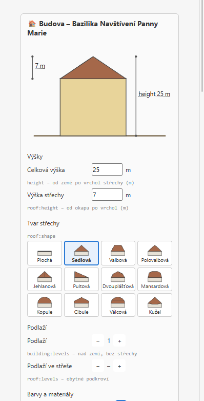

# iD – panel Budova

Uživatelský skript (Tampermonkey) pro editor [iD](https://www.openstreetmap.org/edit) na openstreetmap.org.
Po výběru budovy (`building=*`) nebo části budovy (`building:part=*`) přidá nad formulář
vizuální panel pro 3D atributy – místo hledání klíčů jako `roof:height` nebo `roof:material`.



## Co umí

- **Boční řez** budovy, který se živě překresluje – stěny, střecha, kóty `height`, `roof:height`, `min_height`
  (klik na kótu zaměří pole).
- **Tvar střechy obrázky** – 12 tvarů (`flat`, `gabled`, `hipped`, `half-hipped`, `pyramidal`, `skillion`,
  `gambrel`, `mansard`, `dome`, `onion`, `round`, `cone`) s českými popisky.
- **Podlaží** tlačítky −/+ (`building:levels`, `roof:levels`, u částí `building:min_level`).
- **Barvy** fasády a střechy (vzorky i vlastní barva) a **materiály** s českými názvy.
- **Upozornění** na podezřelé hodnoty: střecha vyšší než budova, `min_height` ≥ `height`,
  pozůstatky importu z RÚIAN (`building:flats` u kostela…), desetinná čárka místo tečky.
- **Věže a části budovy** – návod a předvyplnění věže.
- **Předvolby typů budov** – Panelák, Cihlový bytový dům, Rodinný dům, Řadový dům, Obchodní centrum,
  Hala / sklad, Garáže. Doplní **jen prázdné** hodnoty (tvar a materiál střechy, typ budovy z `yes`,
  výšku z podlaží); pravděpodobný typ podle značek se zvýrazní. Hodnoty jsou v tabulce `PREDVOLBY` ve skriptu.
- **Více budov najednou** – při výběru víc budov stejného typu (`building=`) panel nabídne předvolby
  a „Bez oken“; doplní jen značky, které nemá žádná z nich, ostatní značky nechá být.
- **Dopočet výšky z podlaží** (`height = podlaží × výška patra + střecha`) a upozornění na nereálnou
  výšku patra (pod 2,2 m nebo nad 6 m).
- **Sklon střechy** (`roof:angle`) a u pultové střechy **směr spádu** (`roof:direction`) šipkami.
- **Podzemní podlaží** (`building:levels:underground`), přepínač **Bez oken** (`window=no`).
- **Průjezd** – u části budovy tlačítko „Část nad průjezdem“ (`min_height=4`, `building:min_level=1`)
  a návod (`tunnel=building_passage` na cestě pod budovou).
- Desetinná čárka se při zadání převede na tečku, neplatné číslo se nezapíše.

Panel nic neukládá sám: každá akce je obyčejná úprava v iD (jeden krok **Zpět**),
ukládá se jako vždy tlačítkem **Uložit**.

## Instalace

1. Nainstaluj do prohlížeče rozšíření [Tampermonkey](https://www.tampermonkey.net/)
   (v Chromu v jeho nastavení zapni **„Povolit uživatelské skripty“**).
2. Otevři
   **[budova-panel.user.js](https://raw.githubusercontent.com/MartinSimco/iD-budova-panel/main/budova-panel.user.js)**
   a klikni na **Instalovat**.
3. Otevři editor iD na openstreetmap.org a vyber budovu.

Nové verze stahuje Tampermonkey automaticky.

## Jak to funguje

iD nemá rozhraní pro pluginy a Tampermonkey skript na osm.org spouští až po startu editoru.
Panel proto čte a zapisuje značky přes **textové zobrazení sekce „Značky“** v iD – přesně tak,
jako by je uživatel napsal ručně. Validaci, historii i ukládání tak řeší iD samo.

Pojistky: při výběru více prvků zapisuje jen předvolby a „Bez oken“ (řádky `klíč=*`, které iD
ukazuje u rozdílných hodnot, nechává beze změny – iD je pak přeskočí); nic nezapíše u značek s mezerou na začátku/konci
(změnil by je) ani u neplatných čísel. Při změně rozložení iD se opravují selektory
v objektu `SEL` ve skriptu.

## Test

```
node test_logika.js
```
Testuje čistou logiku (převod značek, čísla, upozornění, boční řez) bez prohlížeče.

## Licence

[GPL-3.0](LICENSE)

---

*English:* A Tampermonkey userscript that adds a visual panel for 3D building attributes
(roof shape picker, side-view section with heights, levels, colours, materials, warnings) to the
iD editor on openstreetmap.org. UI is in Czech.
